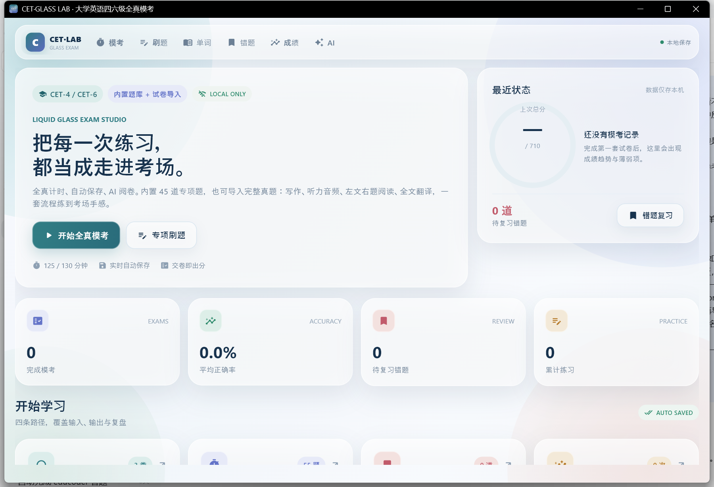

# CET Glass Lab · 大学英语四六级全真模考系统

[](https://www.python.org/)
[](https://flet.dev/)
[](LICENSE)

液态玻璃（Glassmorphism）风格的四六级模考桌面应用。Python / Flet 响应式 UI，桌面端与 Flet 移动端共用一套代码；无后端、无需登录，学习数据与导入试卷全部保存在本地 JSON。



> **仓库不附带官方真题 PDF、答案 PDF 或听力音频。** 这些材料可能受版权保护，请使用你自己合法获取的材料，通过应用内的「导入试卷」功能导入。内置的 45 道专项题为本项目自建的四六级风格题目。

## 功能

### 1. 学习仪表盘
- 模考记录、平均正确率、错题数、累计练习。
- 专项刷题 / 全真模拟 / 错题本 / 历史成绩四个主入口。
- 未完成试卷自动恢复提示；单词本与 AI 设置入口。

### 2. 全真模拟考试
- 从「导入试卷」生成的试卷库中选择试卷，支持四级 125 分钟、六级 130 分钟。
- **严格倒计时**：到点自动交卷；离开考试页后由全局 watchdog 继续计时。
- **写作**：题目 + 大文本输入，实时保存。
- **听力**：进入听力 section 自动播放音频，播放期间没有暂停按钮；音频进度可见。
- **阅读**：左侧完整原文（每段首行缩进两格，可独立上下滚动），右侧顶部是放大的选词词库 / 段落提示（段落提示显示完整首句，悬停可看全段），下方展示当前篇章的全部题目；左右独立滚动。支持选词填空 A-O、段落匹配 A-O、仔细阅读 A-D。
- **翻译**：中文全文 + 大文本输入，实时保存。
- 每次作答、跳题、标记、写作/翻译输入都会写入本地 JSON；关闭程序重新打开可继续。
- 交卷后客观题即时计分；写作/翻译可由 AI 按 15 分制评分，输出总分、单项分、客观题正确率与反馈。
- 支持**无听力试卷**（例如部分六级第三套 PDF 明确不提供听力）：听力可为 0 题，阅读/写作/翻译仍正常计分。

### 3. 专项刷题
- 听力 / 阅读 / 翻译三类；四级/六级筛选。
- 做完一题立即显示标准答案和详细解析；错题自动进入错题本。
- 内置 45 道四六级真题风格题（听力 15 / 阅读 20 / 翻译 10，含 6 道多选）。

### 4. AI 实时划词翻译 + 单词本
- 在阅读原文、翻译原文、写作题目或专项材料中选中英文，700ms 防抖后调用 AI 翻译。
- 翻译面板显示词性、音标、中文释义、例句和上下文，可一键加入**单词本**。
- 单词本支持移除单条、清空全部，记录来源、查询次数与收藏时间。

### 5. AI 写作 / 翻译评分
- 交卷时并行调用 AI 评分，15 分制评分后折算为 106.5 分。
- 结果页展示 AI 总评、优点、提升建议和修改示例。
- AI 未配置或请求失败时仍可完成交卷，并记录评分错误。

### 6. AI 试卷导入
- 上传：真题 PDF（必填）、答案解析 PDF（可选）、听力音频（可选）。
- 识别方式：本地 PDF 文本解析 + AI 视觉识别扫描页 + AI 补全中文解析、写作范文、翻译参考。
- 导入前可设置试卷名称、级别、答题时间。
- 输出固定模板 `cet-glass-paper/v1`，见 [`docs/paper_template.json`](docs/paper_template.json) 与 [`docs/IMPORT_FORMAT.md`](docs/IMPORT_FORMAT.md)。
- 试卷 JSON 与音频保存在本地，可整体复制/备份。

### 7. 错题本 / 历史成绩
- 错题本支持重做、单条移除、一键清空；重做正确后可移出。
- 历史成绩保存每次模考，最近 10 次趋势图，记录写作/听力/阅读/翻译单项分与 AI 反馈。

## 技术结构

```
main.py                     Flet 入口
cetapp/
  app.py                    应用壳、路由、导航、AI 设置、划词翻译、全局超时
  paperlib.py               试卷库、cet-glass-paper/v1 校验、710 分制评分
  pdf_import.py             PDF 提取/解析、AI 视觉 OCR、AI 解析与范文
  ai_agent.py               OpenAI-compatible AI 网关（翻译/评分/视觉）
  scoring.py                计时、会话、内置 45 题库评分
  exam_service.py           交卷用例（历史 + 错题 + 清空会话，单次落盘）
  store.py                  用户数据/错题/单词本/历史 JSON 原子读写
  questions.py              内置题库加载与校验
  question_data.py          随包兜底题库
  views/paper_exam.py       全真模考（写作/听力/阅读/翻译）
  views/import_paper.py     试卷导入 UI
  views/wordbook.py         单词本
  views/...                 仪表盘、专项、错题、历史、成绩
assets/
  questions.json            45 道专项题库
  papers/                   自行放置有再分发权的试卷；仓库默认不含真题
  app.ico / app_icon.png
docs/
  paper_template.json       固定导入模板
  IMPORT_FORMAT.md          导入字段说明
  AI_INTEGRATION.md         AI 接入说明
tests/                      17 个单元测试（含自建 demo 试卷 fixture）
```

- **UI**：Flet 1.0（Flutter 渲染），`ResponsiveRow`、可滚动分栏、窄屏自动叠放；顶部导航在窄屏自动收成图标模式。
- **音频**：`flet-audio` 1.0.5；听力音频作为本地文件播放，界面上没有暂停控件。
- **PDF**：`pypdf` 提取文本与扫描页图片，`Pillow` 处理图像，扫描页交给 AI 视觉模型转写。
- **持久化**：标准库 JSON，临时文件 + `os.replace` 原子替换；文件损坏自动备份并重建。
- **Windows 标题栏**：通过 DWM immersive dark mode 让最小化/最大化/关闭按钮在浅色玻璃主题下保持可见。

## 快速开始

需要 Python 3.10+（开发环境已验证 3.14.7）。

```powershell
git clone <your-repo-url>
cd cet-glass-lab
python -m venv .venv
.\.venv\Scripts\Activate.ps1
pip install -r requirements.txt
flet run main.py
```

或：

```powershell
python main.py
```

进入 **全真模考 → 导入试卷**，上传自己的题卷/答案/音频即可开始。

## AI 配置（可选）

点击顶部 **AI**，或仪表盘的「AI 设置」，填写：

- Base URL：例如 `https://api.deepseek.com/v1`
- 模型：例如 `deepseek-flash`（需要图片输入才能识别扫描版 PDF）
- API Key
- 启用 AI

API Key 只保存在本机：

| 场景 | 配置路径 |
|---|---|
| 开发 | `data/ai_config.json` |
| exe | `%APPDATA%\CETGlassLab\ai_config.json` |

也可以复制 [`docs/ai_config.example.json`](docs/ai_config.example.json) 后填写。**不要提交 `data/ai_config.json` 或任何真实 Key。** 详细说明见 [`docs/AI_INTEGRATION.md`](docs/AI_INTEGRATION.md)。

## 数据存储

| 内容 | 路径 |
|---|---|
| 用户数据（历史/错题/单词本/进行中的考试） | 开发：`data/user_data.json`；exe：`%APPDATA%\CETGlassLab\user_data.json` |
| 导入试卷 | 同目录 `papers/<id>/paper.json` + 音频 |
| AI 配置 | `ai_config.json` |

`data/` 下的运行时文件都已在 `.gitignore` 中忽略。删除 `user_data.json` 会重置用户数据，不影响导入的试卷文件。

## 打包 Windows exe

```powershell
powershell -ExecutionPolicy Bypass -File .\build.ps1
```

产物：`dist\CET-Glass-Lab.exe`。脚本会先编译检查、跑单元测试，再通过 `flet pack` / PyInstaller 打包单文件 exe。

打包产物不建议提交到 Git；请在 GitHub Releases 中发布。

## 测试

```powershell
python -m unittest discover -s tests -v
```

当前 17 个测试：45 题库校验、全对/空卷评分、多选精确匹配、计时、JSON 持久化、错题、原子交卷、损坏恢复、AI 未配置离线、AI JSON 解析、单词本持久化、自建 demo 试卷评分、导入试卷保存。

## 项目约定

- 不提交官方真题原文、答案、听力音频或扫描页；示例/测试使用自建内容。
- 不提交 API Key、用户历史、错题、单词本、导入试卷。
- 提交前运行 `python -m unittest discover -s tests`。
- 详见 [`CONTRIBUTING.md`](CONTRIBUTING.md) 与 [`SECURITY.md`](SECURITY.md)。

发布到 GitHub 的检查清单与建议设置见 [`docs/PUBLISHING.md`](docs/PUBLISHING.md)。

## License

代码以 [MIT License](LICENSE) 开源。第三方依赖与素材说明见 [`THIRD_PARTY_NOTICES.md`](THIRD_PARTY_NOTICES.md)。

本项目与教育部教育考试院 / NEEA 无关联；CET 是其各自权利人的商标/考试名称，仅用于描述兼容的练习场景。
